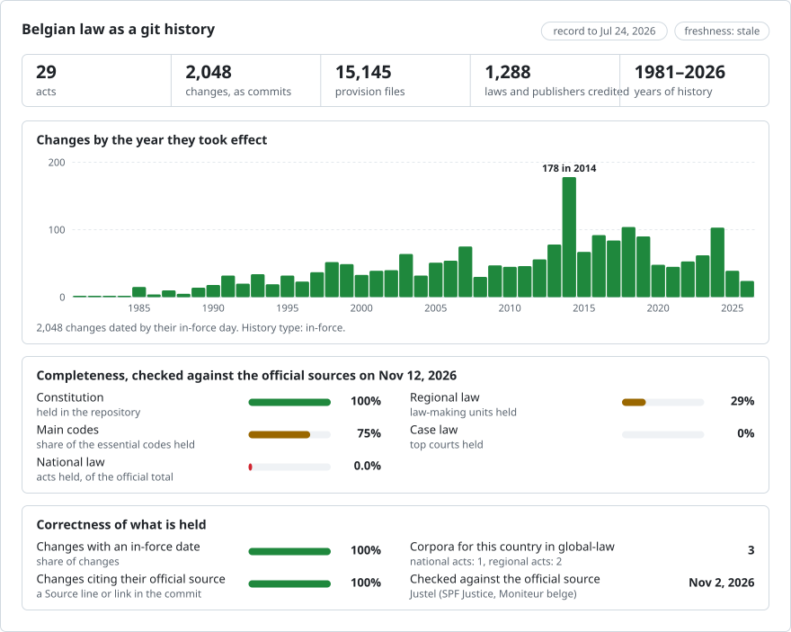

# Belgium: law history in git

**English** · **[Of lees het in het Nederlands](README.md)**

<picture>
<source media="(prefers-color-scheme: dark)" srcset="data/effort-dark.svg">

</picture>

The law of Belgium as a git history: one file per article, one commit per version on the day it took effect, and the act that made each change as the commit's author. `git blame` names the act behind every paragraph; `git log` lists every change to an article; picking a date gives the text in force that day.

Part of [lexifina/global-law](https://github.com/lexifina/global-law), one git history for every country's law: this is Belgium's national law, which global-law reads at `belgium/national/acts/`.

**What is in it now:** the Constitution and 23 codes and laws, with 2,095 versions from Justel: among them the Code pénal, the old and new Code civil, the Code judiciaire, the Code d'instruction criminelle (as Justel's eight texts), the Code de droit économique, the Code des sociétés et des associations, four labour laws and the loi sur les étrangers. Five of them are also given in Dutch. Each act's folder has a `README.md` listing every article and when it changed; [`data/laws.csv`](data/laws.csv) lists every amending act.

Each act is a folder, one file per article (`loi-contrats-travail/art-037.md` is art. 37 of the Loi relative aux contrats de travail of 3 July 1978; `art-007-bis.md` is art. 7bis, `art-112-01.md` art. 112/1).

The text is in French, as Justel prints it; the Constitution (`grondwet/`), the Code pénal (`strafwetboek/`) and three texts of the Code d'instruction criminelle (`wetboek-van-strafvordering-*/`) are also in Dutch. The German text, equally official, is not here, and an English translation is not part of this record.

## Questions as git commands

| Question | Command |
| --- | --- |
| Every change to art. 37 of the Loi relative aux contrats de travail | `git log -p --word-diff -- loi-contrats-travail/art-037.md` |
| Which act wrote each paragraph of art. 37? | `git blame loi-contrats-travail/art-037.md` |
| Every version of the Loi relative aux contrats de travail, with the day each took effect | `git log --format="%h %(trailers:key=In-force,valueonly,separator=) %an" -- loi-contrats-travail` |
| Art. 37 as in force on 1 January 2000 | `python tools/en_vigueur_au.py 2000-01-01 loi-contrats-travail 37` |

**Outside git**, we also host this record publicly, for free:

- **[Ask Claude about Belgian law](https://global-law.lexifina.com/v1/try_claude?country=belgium)**: opens Claude with a first question ready.
- **[Ask ChatGPT](https://global-law.lexifina.com/v1/try_chatgpt?country=belgium)**: the same question in ChatGPT.
- **[Call the API in your browser](https://global-law.lexifina.com/v1/search_law?query=vacances+annuelles&jurisdictions=belgium)**: a search of Belgian law for "vacances annuelles", returned as JSON. See the [documentation here](https://lexifina.com/api/global-law).

Both assistants read the record through the free Global law connector (MCP, `https://global-law.lexifina.com/mcp`); the first time, the chat gives you the link that adds it. Ask in French, in Dutch or in English.

**Host it yourself easily.** All it takes is git and Python, and the tools run on your machine:

```sh
git clone --depth 1 https://github.com/lexifina/global-law && cd global-law
python3 tools/countries.py add belgium/national/acts
python3 tools/law.py show 2026-01-01 belgium/national/acts/loi-contrats-travail/art-037.md
```

Opened in Claude Code, Cursor, VS Code or Codex, the clone also starts a local MCP server with the same tools ([MCP.md](https://github.com/lexifina/global-law/blob/main/MCP.md)).

## Dates

Each commit is dated at noon, Europe/Brussels, on the day the change took effect, and carries it in its `In-force:` trailer:

- the day is the one Justel prints in its note on the change (`<L 1997-02-28/31, art. 1, 004; En vigueur : 01-03-1997>`), which applies the act's own clause or the default rule (loi du 31 mai 1961, art. 4: the tenth day after publication in the Moniteur belge);
- in the Code pénal, the Code judiciaire, the Code d'instruction criminelle, the Code de droit économique, the Code des sociétés et des associations, the labour laws and the loi sur les étrangers, a change Justel dates before its publication is committed on the day it was published; `REPRODUCE.md` lists each one with both days;
- a wording Justel notes as "En vigueur : indéterminée", or prints ahead of time as "Droit futur", is not read as text in force; the one change due later (1 May 2027) is on the `futur` branch.

Each change is credited to the act that made it, with Justel's citation (`L 2014-01-06/42`, `AR 1991-05-21/31`, `C. const. 148/2017` for a Constitutional Court ruling). The first commit of the Constitution (the coordinated text of 17 February 1994), the new Code civil, the Code de droit économique and the Code des sociétés et des associations is the act as enacted; every other act's first commit is the "oldest version available", credited to Justel, as are changes Justel shows without a dated note (mostly its own corrections).

## How it is checked

- Every archived Justel page used is compared, article by article, with this history on the page's own day, ignoring typesetting; the newest page of each act matches, except for the timing differences named in `REPRODUCE.md`.
- `tools/check_repo.py` reads every version back from git on the day it took effect and on the day before, and both must match the corpus: 2,095 versions, no mismatch.
- A second build from the same corpus gave identical hashes.
- History is append-only: no merge commits, no dates going backwards, nothing dated in the future, and every commit's trailers parse.

## What it does not show

- **Texts before Justel's archive.** Most acts start at the oldest text Justel keeps or the oldest archived Justel page (the Code pénal in 1990, the Code judiciaire in 1985, the old Code civil and the Code d'instruction criminelle in 2009), not as enacted.
- **The newest changes to some acts.** Where no newer Justel page was available, the history ends earlier (the Code de droit international privé and the loi sur les accidents du travail in 2024; the old Code civil's parts between 2021 and 2026).
- **The new Code pénal** (lois du 29 février 2024): not built, and its replacement of the 1867 Code is not committed.
- **Other law.** Only these 24 acts are here: no other laws or decrees, no case law, and no German text or Dutch text of the other 19 acts.
- **Headings** (titles, chapters, sections) and the annexes of the Code de droit économique: only articles are files.

## Sources

| Source | Kind | Past versions | Notes |
| --- | --- | --- | --- |
| [Justel](https://www.ejustice.just.fgov.be/cgi_loi/welcome.pl?language=fr) (SPF Justice, Moniteur belge) | Official consolidated legislation | "versions archivées" per act | A dated note per change names the amending act and its in-force day; read through the two copies below |
| [legalize-be](https://github.com/legalize-dev/legalize-be) (Legalize), commit `da37dfb18b17` | Justel's archived versions as Markdown | one commit per archived version | The older versions of most acts, redated here by Justel's notes (its own dates are not used) |
| [Internet Archive](https://web.archive.org/) | Archived Justel pages | one per capture | The newest texts, the acts legalize-be lacks, the Dutch texts, and the checks |

## Licence

See [`LICENSE`](LICENSE). Official acts are not protected by copyright in Belgium (Code de droit économique, art. XI.172, § 2); legalize-be's data is under the "Licence ouverte / open data fédéral belge (CC0 par défaut)". Lexifina's own contributions (the history, commit messages, tables and tools) are CC0 1.0.

No AI model wrote, translated or corrected legal text; the scripts were written by an AI model (see [`REPRODUCE.md`](REPRODUCE.md)).

## More

From [lexifina/global-law](https://github.com/lexifina/global-law):

- [FEATURES.md](https://github.com/lexifina/global-law/blob/main/FEATURES.md): every feature, and what every corpus must support (`git blame`, `law.py`, the MCP tools)
- [FAQ.md](https://github.com/lexifina/global-law/blob/main/FAQ.md): questions and answers · [CONTRIBUTING.md](https://github.com/lexifina/global-law/blob/main/CONTRIBUTING.md): proposing changes · [MCP.md](https://github.com/lexifina/global-law/blob/main/MCP.md): the MCP server · [REPRODUCE.md](https://github.com/lexifina/global-law/blob/main/REPRODUCE.md): how it was built · [CHANGELOG.md](https://github.com/lexifina/global-law/blob/main/CHANGELOG.md)
- [FRESHNESS.md](https://github.com/lexifina/global-law/blob/main/FRESHNESS.md): how current each corpus is · [Monitoring](https://github.com/lexifina/global-law/tree/main/monitoring): whether updates are running · [WATCHING.md](https://github.com/lexifina/global-law/blob/main/WATCHING.md): how each official source is watched for changes
- [performance/](https://github.com/lexifina/global-law/tree/main/performance): how fast the tools are, measured
- [visualisations/](https://github.com/lexifina/global-law/tree/main/visualisations): charts and bridges across the world's law
- [Vulnerabilities](https://github.com/lexifina/global-law/tree/main/vulnerabilities): mistakes in legislation as published
