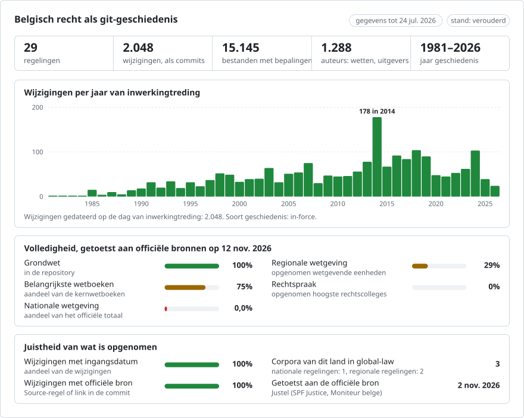

# België: de geschiedenis van het recht in git

**Nederlands** · [English](README.en.md)

<picture>
<source media="(prefers-color-scheme: dark)" srcset="data/nl/effort-dark.svg">

</picture>

Onderdeel van [lexifina/global-law](https://github.com/lexifina/global-law), één git-geschiedenis voor het recht van elk land: dit is het nationale recht van België, dat global-law leest in `belgium/national/acts/`.

Het recht van België als git-geschiedenis: één bestand per artikel, één commit per wet op de dag van inwerkingtreding, en de wet die elke wijziging aanbracht als auteur van de commit. `git blame` noemt de wet achter elke alinea; `git log` toont elke wijziging van een artikel; een datum uitchecken geeft de tekst die op die dag van kracht was. De tekst is Frans; de Grondwet en drie teksten van de Code d'instruction criminelle (livre II, titres II, III en V-VI) staan ook in het Nederlands (`grondwet/` en `wetboek-van-strafvordering-*/`, volgens de Nederlandse pagina's van Justel). Nederlands en Duits zijn evenzeer officieel; de andere Nederlandse teksten en de Duitse teksten zijn nog niet gebouwd.

Ze volgt het gemeenschappelijke ontwerp van [lexifina/global-law](https://github.com/lexifina/global-law), dat haar plaatst in `be/`.

**Wat er nu in staat**

| Map | Tekst | Versies | Geschiedenis |
| --- | --- | ---: | --- |
| `constitution/` | La Constitution coordonnée (17 février 1994) | 37 | Vanaf de gecoördineerde tekst (van kracht op 27 februari 1994) via elke herziening tot L 2026-07-15/04 (24 juli 2026) |
| `code-penal/` | Code pénal (8 juin 1867) | 175 | Vanaf 5 april 1990 (de oudste tekst die Justel bewaart, niet de tekst van 1867) tot de bijwerking van Justel van 18 februari 2026, gelezen op 3 mei 2026 |
| `grondwet/` | De gecoördineerde Grondwet (17 februari 1994): de Grondwet in het Nederlands | 17 | Vanaf 2 december 2008 (de oudste gearchiveerde Nederlandse pagina van Justel, niet de tekst van 1994) tot de Nederlandse pagina van Justel van 4 juli 2025 |
| `strafwetboek/` | Strafwetboek (8 juni 1867): de Code pénal in het Nederlands | 89 | Vanaf 5 februari 2012 (de oudste gearchiveerde Nederlandse pagina van Justel, niet de tekst van 1867) tot de Nederlandse pagina van Justel van 16 mei 2026 |
| `wetboek-van-strafvordering-boek-2-titel-2/` | Wetboek van strafvordering, boek II, titel II (9 december 1808): livre II, titre II in het Nederlands | 18 | Vanaf 15 februari 2014 (de oudste gearchiveerde Nederlandse pagina van Justel, niet de tekst van 1808) tot de Nederlandse pagina van Justel van 15 juli 2023 |
| `wetboek-van-strafvordering-boek-2-titel-3/` | Wetboek van strafvordering, boek II, titel III (10 december 1808): livre II, titre III in het Nederlands | 1 | Vanaf 4 september 2019 (de oudste gearchiveerde Nederlandse pagina van Justel) tot de Nederlandse pagina van Justel van 10 mei 2022 (geen wijziging daartussen) |
| `wetboek-van-strafvordering-boek-2-titels-5-6/` | Wetboek van strafvordering, boek II, titels V en VI (14 december 1808): livre II, titres V-VI in het Nederlands | 3 | Vanaf 25 mei 2015 (de oudste gearchiveerde Nederlandse pagina van Justel) tot de Nederlandse pagina van Justel van 25 september 2021 |
| `ancien-code-civil/` | Code civil (21 mars 1804), het "ancien Code civil" | 114 | Vanaf 16 december 2009 (de oudste gearchiveerde pagina van Justel) tot de nieuwste gearchiveerde pagina van elk deel (2021-2026) |
| `code-civil/` | Code civil (2019-): livres 1, 2 (titre 3), 3, 4, 5, 6, 8 en 9 (titre 1) | 9 | Elk boek vanaf zijn inwerkingtreding (livre 8: 1 november 2020 ... livre 9, titre 1: 1 januari 2026) |
| `titre-preliminaire-code-procedure-penale/` | Loi contenant le titre préliminaire du Code de procédure pénale (17 avril 1878) | 60 | Vanaf 31 december 1993 (de oudste tekst die Justel bewaart) tot de pagina van Justel van 9 mei 2024 |
| `code-instruction-criminelle-livre-1/` | Code d'instruction criminelle, livre premier (17 novembre 1808) | 78 | Vanaf 16 december 2009 (de oudste gearchiveerde pagina van Justel, niet de tekst van 1808) tot de pagina van Justel van 9 oktober 2025 |
| `code-instruction-criminelle-livre-2-titre-1/` | Code d'instruction criminelle, livre II, titre Ier (19 novembre 1808) | 40 | Vanaf 16 december 2009 (de oudste gearchiveerde pagina van Justel, niet de tekst van 1808) tot de pagina van Justel van 10 maart 2024 |
| `code-instruction-criminelle-livre-2-titre-2/` | Code d'instruction criminelle, livre II, titre II (9 décembre 1808) | 25 | Vanaf 16 december 2009 (de oudste gearchiveerde pagina van Justel, niet de tekst van 1808) tot de pagina van Justel van 23 juli 2023 |
| `code-instruction-criminelle-livre-2-titre-3/` | Code d'instruction criminelle, livre II, titre III (10 décembre 1808) | 10 | Vanaf 16 december 2009 (de oudste gearchiveerde pagina van Justel, niet de tekst van 1808) tot de pagina van Justel van 22 november 2022 |
| `code-instruction-criminelle-livre-2-titre-4/` | Code d'instruction criminelle, livre II, titre IV (12 décembre 1808) | 21 | Vanaf 16 december 2009 (de oudste gearchiveerde pagina van Justel, niet de tekst van 1808) tot de pagina van Justel van 27 februari 2026 |
| `code-instruction-criminelle-livre-2-titres-5-6/` | Code d'instruction criminelle, livre II, titres V et VI (14 décembre 1808) | 5 | Vanaf 16 december 2009 (de oudste gearchiveerde pagina van Justel, niet de tekst van 1808) tot de pagina van Justel van 2 juni 2024 |
| `code-instruction-criminelle-livre-2-titre-7/` | Code d'instruction criminelle, livre II, titre VII (16 décembre 1808) | 22 | Vanaf 16 december 2009 (de oudste gearchiveerde pagina van Justel, niet de tekst van 1808) tot de pagina van Justel van 31 januari 2024 |
| `code-judiciaire/` | Code judiciaire (10 octobre 1967), deel een tot zeven | 618 | Vanaf 22 januari 1985 (de oudste tekst die Justel bewaart) tot de nieuwste gearchiveerde pagina van Justel van deel een tot zes (mei 2024 tot mei 2026) en de laatste versie van legalize-be van deel zeven |
| `code-nationalite/` | Code de la nationalité belge (28 juin 1984) | 28 | Vanaf 6 juli 1991 (de oudste tekst die Justel bewaart) tot de pagina van Justel van 3 juli 2025 |
| `code-electoral/` | Code électoral (12 avril 1894) | 36 | Vanaf 10 januari 2003 (de oudste tekst die Justel bewaart) tot de pagina van Justel van 5 mei 2024 |
| `code-droit-international-prive/` | Loi portant le Code de droit international privé (16 juillet 2004) | 25 | Vanaf de inwerkingtreding (1 oktober 2004) tot de laatste versie van legalize-be (bijwerking van Justel van 29 maart 2024) |
| `loi-protection-donnees/` | Loi relative à la protection des personnes physiques à l'égard des traitements de données à caractère personnel (30 juillet 2018) | 8 | Vanaf de inwerkingtreding (5 september 2018) tot de pagina van Justel van 7 mei 2026 |
| `loi-bien-etre-travailleurs/` | Loi relative au bien-être des travailleurs lors de l'exécution de leur travail (4 août 1996) | 52 | Vanaf 1 oktober 1996 (de oudste tekst die Justel bewaart) tot de pagina van Justel van 25 juli 2025 |
| `loi-sur-le-travail/` | Loi sur le travail (16 mars 1971) | 54 | Vanaf 24 januari 1985 (de oudste tekst die Justel bewaart) tot de pagina van Justel van 21 februari 2026 |
| `loi-contrats-travail/` | Loi relative aux contrats de travail (3 juillet 1978) | 116 | Vanaf 28 april 1981 (de oudste tekst die Justel bewaart) tot de pagina van Justel van 19 mei 2026 |
| `loi-etrangers/` | Loi sur l'accès au territoire, le séjour, l'établissement et l'éloignement des étrangers (15 décembre 1980) | 131 | Vanaf 26 juli 1991 (de oudste tekst die Justel bewaart) tot de pagina van Justel van 21 augustus 2025 |
| `loi-accidents-travail/` | Loi sur les accidents du travail (10 avril 1971) | 109 | Vanaf 8 juli 1981 (de oudste tekst die Justel bewaart) tot de laatste versie van legalize-be (bijwerking van Justel van 5 juni 2024) |
| `code-societes-associations/` | Code des sociétés et des associations (23 mars 2019) | 32 | Vanaf de Code zoals aangenomen (van kracht op 1 mei 2019) tot de pagina van Justel van 29 april 2026 |
| `code-droit-economique/` | Code de droit économique (28 février 2013) | 162 | Elk boek vanaf de dag van zijn inwerkingtreding (vanaf 6 september 2013) tot de pagina van Justel van 9 juni 2026, plus één wijziging die vermeld staat als van kracht op 1 mei 2027 (toekomstige tak) |

De `README.md` per tekst in elke map vermeldt elk artikel, hoe vaak het is gewijzigd en wanneer.

## Vragen van een jurist als git-commando's

| Vraag | Commando |
| --- | --- |
| Wat zei art. 151 van de Grondwet op 30 januari 2014? | `python tools/en_vigueur_au.py 2014-01-30 constitution 151` |
| Hetzelfde, met git zelf (bash) | `git show $(git rev-list -1 --before="2014-01-30T23:59:59Z" main -- constitution/art-151.md):constitution/art-151.md` |
| Hetzelfde, in PowerShell | `$r = git rev-list -1 --before="2014-01-30T23:59:59Z" main -- constitution/art-151.md; git show "$($r):constitution/art-151.md"` |
| Welke wet schreef elke alinea van art. 41? | `git blame constitution/art-041.md` |
| Elke wijziging van art. 458 van de Code pénal, woord voor woord | `git log -p --word-diff code-penal/art-458.md` |
| Elke wet in de geschiedenis, in volgorde | `git log --reverse --format="%ad %an" --date=short main` |
| Alles wat één wet heeft gewijzigd | `git log --author="L 2014-01-06/42" main` |
| De hele Grondwet op een datum | `python tools/en_vigueur_au.py 2000-01-01 constitution` |

Bestandsnamen: `art-007-bis.md` is art. 7bis, `art-112-01.md` art. 112/1, `art-344-001.md` art. 344-1 van de oude Code civil, `art-5-201.md` art. 5.201 van de nieuwe Code civil, `disp-trans-04.md` de overgangsbepaling IV van de Grondwet. Haal na een herbouw de tags opnieuw op met `git fetch --force --tags`.

## Datums

- Elke commit is gedateerd op **12 uur 's middags, Europe/Brussels, op de dag waarop de wijziging in werking trad**, en die dag staat in de trailer `In-force:`, die de tools lezen.
- **Waar de dag vandaan komt.** Justel, de geconsolideerde wetgeving van de FOD Justitie (Belgisch Staatsblad), vermeldt elke wijziging in de tekst: `<L 1997-02-28/31, art. 1, 004; En vigueur : 01-03-1997>` noemt de wijzigende akte (haar datum en volgnummer bij Justel), het artikel dat de wijziging aanbracht, het nummer van de gearchiveerde versie bij Justel en de dag van inwerkingtreding. Elke datum hier is de dag van inwerkingtreding uit zo'n nota. De dag van Justel past de algemene regel toe (wet van 31 mei 1961, art. 4: een wet is verbindend vanaf de tiende dag na haar bekendmaking in het Belgisch Staatsblad) of de eigen bepaling van de akte.
- **De datums van legalize-be worden niet gebruikt.** legalize-be (hieronder) dateert elke commit op de bekendmaking van de wijzigende akte, vaak plus tien dagen, en valt daarop terug wanneer de dag van inwerkingtreding bij Justel "indéterminée" is; hier dateren alleen de nota's van Justel een wijziging.
- **Terugwerkende en niet-gedateerde wijzigingen (de Code pénal, de vier arbeidswetten, de loi sur les étrangers, de Code des sociétés et des associations, de Code de droit économique, de Code judiciaire en de Code d'instruction criminelle).** Waar de dag van inwerkingtreding die Justel voor een wijziging geeft vroeger valt dan de dag waarop de wijzigende akte in het Belgisch Staatsblad werd bekendgemaakt, wordt de wijziging gecommit op de dag van bekendmaking, en `decisions` in `REPRODUCE.md` vermeldt elk geval met beide dagen. Een formulering waarvan de enige nieuwe nota "En vigueur : indéterminée" luidt (Justel drukt ze vooraf af, cursief) wordt weggelaten: de formulering ervoor blijft van kracht. De dag van bekendmaking wordt gelezen uit de eigen Justel-fiche van de wijzigende akte of, waar die er geen heeft, uit de lijst van wijzigende akten die Justel bij de gewijzigde akte afdrukt (voor één besluit: het koninklijk besluit van 21 mei 1991, bekendgemaakt op 28 mei 1991, dat art. 63 van de loi relative aux contrats de travail wijzigde met ingang van 1 mei 1991). Waar geen bron de dag van bekendmaking van zo'n akte geeft, heeft haar terugwerkende formulering geen dag waarop ze kan worden gecommit en wordt ze weggelaten zoals een niet-gedateerde (het koninklijk besluit van 7 december 1992 over art. 40 van de loi sur les étrangers, waarvan de wet van 6 mei 1993 de woorden verving, en 23 formuleringen van de Code judiciaire, elk genoemd in `decisions`). Waar een latere akte een bepaling wijzigde met ingang van de dag waarop een eerdere wijziging ervan in werking trad, treedt de eerdere formulering op haar eigen dag in en alleen de latere wijziging op de dag van bekendmaking van de latere akte (één geval: art. XVII.1 van de Code de droit économique, ingevoegd met ingang van 10 juni 2024 door de wet van 21 april 2024 en met ingang van die dag gewijzigd door de wet van 20 april 2026, bekendgemaakt op 7 mei 2026). In de loi sur les étrangers, de loi sur les accidents du travail, de Code judiciaire, de Code d'instruction criminelle, de loi relative aux contrats de travail en de loi sur le travail dateert een nota "En vigueur : indéterminée et au plus tard 01-06-2008" (de akte liet de dag over aan de Koning, uiterlijk op die dag) haar wijziging op die uiterste dag; de wijziging kan eerder van toepassing zijn geweest. In de loi sur les accidents du travail en de Code judiciaire wordt dezelfde nota, geschreven als "au plus tard : 01-05-2008" of "au plus tard le 1-09-2016", op dezelfde manier gelezen (accidents du travail: art. 7 en 84bis, wet van 1 april 2007, op 1 mei 2008), en in livre II, titres II tot VII, van de Code d'instruction criminelle ook "au plus tard au 07-04-2018" (art. 646, wet van 18 maart 2014, op 7 april 2018). In de twee laatste treden tien bepalingen die vanaf 2010 zo vermeld staan in op die uiterste dag (1 juli 2011, de dag die Justel later vermeldt). In de loi sur les accidents du travail wordt een wijziging zonder nieuwe gedateerde nota (meestal correcties van Justel zelf) die een latere pagina van Justel nog steeds niet toont, gedateerd op de eerste bron na die pagina die ze wel toont, en art. 38bis, dat Justel nu 38/1 nummert, is één bepaling onder 38/1. De oudere delen behouden in al deze gevallen de dag van inwerkingtreding van Justel.
- **Toekomstige formuleringen ("Droit futur").** Justel, en legalize-be in navolging daarvan, drukt soms de toekomstige formulering van een bepaling af naast de geldende, gemarkeerd als "Droit futur": in het artikel na de geldende tekst, of als een afzonderlijk artikel. Die kopie was nooit van kracht en wordt niet als tekst gelezen (de Grondwet heeft er geen): de geldende formulering blijft tot de toekomstige formulering in werking treedt, op de dag van inwerkingtreding die haar eigen nota geeft, en `decisions` in `REPRODUCE.md` noemt elke bepaling. Waar Justel een formulering als toekomstig bleef afdrukken na de dag van inwerkingtreding die haar nota geeft (Code pénal art. 458bis, 1 maart tot 26 september 2013), luidt de bepaling voor die tussenperiode `[La source ne donne pas le texte en vigueur à cette date.]`.
- Waar een formulering tegelijk nota's met twee dagen van inwerkingtreding kreeg, luidt ze tussen die twee dagen `[La source ne donne pas le texte en vigueur à cette date.]`. Waar Justel een wijziging toont zonder nieuwe gedateerde nota (meestal correcties van zijn eigen tikfouten), is de wijziging een afzonderlijke commit met Justel als auteur, gemarkeerd als onverklaard en gedateerd op de versie of pagina van Justel die ze het eerst toont.
- Gebruik `T23:59:59Z` met `--before`, of de tool: een datum zonder tijdstip gebruikt het uur van uw eigen klok.

## Hoe de geschiedenis werd gereconstrueerd

**Grondwet, Code pénal en de andere wetboeken.** Justel bewaart elke gearchiveerde versie van een akte ("versions archivées"). [legalize-be](https://github.com/legalize-dev/legalize-be) (vastgezet op `da37dfb18b17`) reconstrueert die gearchiveerde versies als Markdown, één commit per versie. Die geschiedenis is niet bruikbaar zoals ze is, en werd ook niet zo gebruikt:

- het eerste bestand van elke akte mengt de oudste gearchiveerde tekst (voor artikelen die later zijn gewijzigd) met de tekst van vandaag (voor de rest, ook voor later ingevoegde artikelen: 7bis, 22ter en 135bis van de Grondwet staan in het bestand van "1994");
- de latere bestanden bevatten alleen de artikelen die tot dan toe zijn gewijzigd, en de nieuwe formulering van een artikel verschijnt vaak pas verscheidene gearchiveerde versies na de versie die ze invoerde;
- de commitdatums zijn datums van bekendmaking (vaak plus tien dagen), geen dagen van inwerkingtreding; sommige artikelen van de Code pénal zijn verkeerd gelabeld of lopen in elkaar over.

Daarom worden de opeenvolgende formuleringen van elk artikel gelezen in de bestandsvolgorde van legalize-be en wordt elke formulering gedateerd met de nota's van Justel die ze kreeg. Een later ingevoegd artikel wordt weggelaten tot de dag van inwerkingtreding van zijn nota "Inséré par". De nieuwste tekst komt van een gearchiveerde pagina van Justel (Internet Archive) die nieuwer is dan het laatste bestand van legalize-be: voor de Grondwet de pagina van 24 augustus 2026, die de herzieningen van 12 juni 2025 en 15 juli 2026 toevoegt die legalize-be mist.

**Code judiciaire.** Hij wordt gebouwd zoals de wetboeken hierboven, uit de bestanden van legalize-be voor zijn zeven delen. Die bestanden lopen achter op Justel voor de delen twee, vier en vijf (hun laatste bestanden dateren van vóór wijzigingen die ze al vermelden), dus wordt elke bepaling ook gelezen uit de nieuwste gearchiveerde pagina's van Justel van haar deel: de formulering van een pagina wordt overgenomen, tenzij de formulering hier van na die pagina dateert. De pagina's van Justel geven tabellen weer als losse cellen, waar legalize-be Markdown-tabellen behoudt; ze worden vergeleken zonder die opmaak.

**Oude en nieuwe Code civil.** legalize-be heeft geen bestand voor de Code civil van 1804, en ook niet voor de geconsolideerde boeken van de nieuwe. Een wijziging die tussen twee opnamen werd aangebracht en weer vervangen, is niet te zien.

**Code des sociétés et des associations.** Ook daarvan heeft legalize-be geen geschiedenis. Hij wordt alleen gelezen uit de geconsolideerde pagina van Justel zoals gearchiveerd op 35 dagen van 16 oktober 2019 tot 29 april 2026, uitgaande van de Code zoals aangenomen (van kracht op 1 mei 2019; de pagina van Justel van oktober 2019 bevat geen wijzigingsnota), en op dezelfde manier gedateerd met de nota's van Justel. Justel nummert de artikelen per boek (1:1, 7:127); het artikel dat de wet van 20 december 2020 na art. 10:6 invoegde, staat op de pagina's van Justel van 2021 als "Art. 10:6/1" en op de latere als "Art. 10", en wordt behouden als 10:6/1. Waar Justel de toekomstige formulering van een artikel naast de geldende afdrukt ("Droit futur"), wordt alleen de geldende formulering gebruikt. Een wijziging die tussen twee pagina's werd aangebracht en weer vervangen, is niet te zien.

**Code de droit économique.** Ook daarvan heeft legalize-be geen geschiedenis. Hij wordt alleen gelezen uit de geconsolideerde pagina van Justel zoals gearchiveerd op 109 dagen van 13 juni 2014 tot 9 juni 2026 (119 pagina's), en op dezelfde manier gedateerd met de nota's van Justel. Zijn boeken werden door afzonderlijke wetten in de Code ingevoegd, die op verschillende dagen in werking traden, dus treedt elk artikel in op de dag van inwerkingtreding die de nota van Justel geeft voor de wet die het invoegde (boek IV op 6 september 2013, de meeste boeken in 2014); de boeken II en VIII, samen met de Code aangenomen, treden in op de dag van inwerkingtreding van de Code zelf, 12 december 2013. Justel nummert de artikelen per boek in Romeinse cijfers (I.1, XVII.35, VI.83/1); "XVII.1er" en "XVII.1" zijn één artikel, en art. III.73/1, dat Justel vanaf 2019 afdrukt als "Art. III", wordt behouden als III.73/1. De bijlagen die Justel als artikelen afdrukt (N, VII.N3, XII.N1, XII.N2: formulieren en technische bijlagen) zijn niet opgenomen. Art. XVII.1/4, het vroegere art. XVII.1, door de wet van 21 april 2024 vernummerd en uitgebreid, bestaat pas vanaf 10 juni 2024. Op dezelfde manier bestaan artikelen die later zijn toegevoegd onder nummers die geen eerdere gearchiveerde pagina afdrukt, pas vanaf de dag van inwerkingtreding van de wet waarvan de nota hun formulering geeft: VII.147/1 tot VII.147/38 en VII.214/1 tot VII.214/10 (de wet van 22 april 2016, vanaf 1 december 2016; VII.147/1, /27, /31 en /34 bevatten de woorden van de vroegere VII.88, 110, 115 en 118), XX.1 (1 mei 2018), XI.336/3 tot XI.336/5 (24 augustus 2018), XV.125/4 (1 juni 2019) en I.23 (1 september 2023). Waar Justel de toekomstige formulering naast de geldende afdrukt ("Droit futur"), wordt alleen de geldende formulering gebruikt. Een wijziging die tussen twee pagina's werd aangebracht en weer vervangen, is niet te zien.

**Code d'instruction criminelle, livre premier en livre II.** legalize-be heeft er geen bestand voor. Justel splitst de Code in acht teksten: de titre préliminaire du Code de procédure pénale (hierboven), livre premier, en livre II in zes teksten (titres I, II, III, IV, V en VI samen, en VII); elk ervan is hier een akte. Elke tekst wordt alleen gelezen uit de geconsolideerde pagina van Justel van die tekst zoals gearchiveerd vanaf 16 december 2009 (livre premier: 70 pagina's tot 9 oktober 2025; livre II, titre Ier: 46 pagina's tot 10 maart 2024; titre II: 28 pagina's tot 23 juli 2023; titre III: 19 pagina's tot 22 november 2022; titre IV: 24 pagina's tot 27 februari 2026; titres V et VI: 15 pagina's tot 2 juni 2024; titre VII: 28 pagina's tot 31 januari 2024), en op dezelfde manier gedateerd met de nota's van Justel. De eerste versie is de tekst van de oudste gearchiveerde pagina op haar eigen dag, toegeschreven aan Justel, niet de Code zoals aangenomen in 1808. De artikelen 47novies/2 (livre premier, vanaf 17 augustus 2018), 215bis (livre II, het vroegere art. 216, vanaf 29 februari 2016) en 216novies (livre II, titre II, vanaf 1 mei 2010), die Justel zonder nota "Inséré" vermeldt, bestaan pas vanaf de dag van inwerkingtreding van de wet waarvan de nota hun formulering geeft. Twee wetten van 2014 voegden elk een art. 646 in titre VII in: de tekst van de wet van 10 april 2014 (gerechtsdeskundigen) is van kracht vanaf 1 december 2016 en de tekst van de wet van 18 maart 2014 vanaf 7 april 2018 (uiterlijk, zoals Justel het vermeldt); de kopie van die laatste die Justel vanaf 2014 afdrukte, voordat ze in werking trad, wordt niet als geldende tekst gelezen. De pagina's van Justel van 10 juni 2017 en 5 september 2018 drukken de tekst over de deskundigen niet meer af, zonder nota die zegt waarom; hij blijft hier van kracht tot 7 april 2018. Waar Justel de toekomstige formulering naast de geldende afdrukt ("Droit futur"), wordt alleen de geldende formulering gebruikt. Een wijziging die tussen twee pagina's werd aangebracht en weer vervangen, is niet te zien.

**De Grondwet in het Nederlands (`grondwet/`).** legalize-be heeft geen Nederlandse tekst. De Nederlandse Grondwet wordt alleen gelezen uit de Nederlandse geconsolideerde pagina van Justel van de Grondwet (hetzelfde tekstnummer als de Franse) zoals gearchiveerd op 71 dagen van 2 december 2008 tot 4 juli 2025. De eerste versie is de tekst van de oudste pagina op haar eigen dag, toegeschreven aan Justel, niet de tekst van 1994 (de Franse `constitution/` heeft de geschiedenis vanaf 1994). De Nederlandse nota's van Justel (`<W 2024-05-15/01, art. 1, 078; Inwerkingtreding : 03-06-2024>`, "Ingevoegd bij", "Opgeheven bij", "onbepaald") worden gelezen zoals de Franse; ze noemen dezelfde akten met dezelfde volgnummers, dus wordt elke wijziging toegeschreven aan dezelfde wet als in de Franse tekst en treedt ze, bepaling per bepaling gecontroleerd, op dezelfde dag in. De 17 wijzigingen zonder gedateerde nota zijn correcties van Justel in de Nederlandse formulering (meestal tikfouten, verbeterd op de pagina van 7 september 2012, en "De wet ... bepalen" in art. 134, in juni 2025 verbeterd tot "Wetten ... bepalen"); elke correctie is een afzonderlijke commit met Justel als auteur, gedateerd op de pagina die ze het eerst toont. De herziening van 15 juli 2026 (art. 195) valt na de nieuwste Nederlandse pagina en is niet in het Nederlands te zien.

**De Code pénal in het Nederlands (`strafwetboek/`).** Alleen gelezen uit de Nederlandse geconsolideerde pagina van Justel van de Code pénal zoals gearchiveerd op 75 dagen van 5 februari 2012 tot 16 mei 2026; de eerste versie is de tekst van de oudste Nederlandse pagina op haar eigen dag, toegeschreven aan Justel. Er zijn te weinig Nederlandse pagina's om elke wijziging te dateren, dus krijgt elke wijziging die in beide talen werd aangebracht de dag en de toeschrijving van dezelfde wijziging in de Franse tekst (`code-penal/`), gekoppeld via de wijzigende akte die beide teksten vermelden; de Nederlandse formulering is die met dezelfde nota's, en waar geen gearchiveerde Nederlandse pagina ze toont, luidt de bepaling "[De bron geeft de tekst die op deze datum van kracht is niet.]". Wijzigingen in slechts één taal behouden hun eigen nota's: L 2019-05-05/10 (art. 43 en 43bis) en L 2018-07-11/02 (art. 37ter) wijzigden alleen de Franse tekst; de akte van 28 maart 2024 (art. 136ter en 136quater) en W 2022-07-30/03 (art. 417/46) alleen de Nederlandse tekst. De twee nota's van Justel voor L 2014-05-05/11 bij art. 71 spreken elkaar tegen (1 januari 2016 in het Nederlands, 1 oktober 2016 in het Frans); art. 136 van de akte zelf, zoals gewijzigd door L 2016-05-04/03, stelt de inwerkingtreding vast op 1 oktober 2016, de dag die in beide teksten wordt gebruikt. De nieuwste Nederlandse pagina komt bepaling per bepaling overeen.

**De Code d'instruction criminelle in het Nederlands (`wetboek-van-strafvordering-boek-2-titel-2/`, `-titel-3/`, `-titels-5-6/`).** Drie van de acht teksten van Justel van de Code staan ook in het Nederlands, alleen gelezen uit de Nederlandse geconsolideerde pagina's van Justel van dezelfde teksten (14, 3 en 3 gearchiveerde pagina's; van 2014, 2019 en 2015 tot 2023, 2022 en 2021). Elke eerste versie is de tekst van de oudste Nederlandse pagina op haar eigen dag, toegeschreven aan Justel. Ze worden gedateerd en toegeschreven volgens dezelfde regels als de Franse teksten, en bepaling per bepaling daarmee vergeleken: elke wijziging die in beide talen werd aangebracht, treedt op dezelfde dag in, toegeschreven aan dezelfde wet. Eén wijziging staat alleen in de Nederlandse tekst: L 2016-02-05/11, art. 105 schrapte woorden uit het Nederlandse art. 329bis (van kracht op 29 februari 2016); de Franse tekst heeft geen dergelijke wijziging. Waar twee wijzigingen tussen twee gearchiveerde Nederlandse pagina's vallen, luidt de bepaling "[De bron geeft de tekst die op deze datum van kracht is niet.]" van de eerste wijziging tot de tweede. Wijzigingen na de nieuwste Nederlandse pagina van elke tekst zijn niet in het Nederlands te zien. De toekomstige formulering die Justel naast de geldende tekst afdrukt ("Toekomstig recht"), wordt nooit als geldende tekst gelezen.

**Opmaak.** De nota's en wijzigingsmarkeringen van Justel (`[¹ ... ]¹`, oudere losse haken) worden verwijderd. Oudere versies van Justel markeren gewijzigde woorden met ronde haken waar nieuwere vierkante haken gebruiken, en Justel heeft later hoofdletters, accenten en slotpunten gelijkgetrokken; waar alleen dat verschilt, krijgt de alinea de laatste weergave van Justel, zodat zulke opschoning niet als wijziging verschijnt. Woorden die door het Grondwettelijk Hof zijn vernietigd (Justel drukt ze cursief af met een nota) worden verwijderd op de dag waarop het arrest in het Belgisch Staatsblad werd bekendgemaakt, toegeschreven aan het arrest.

## Hoe het wordt gecontroleerd

- **Ten opzichte van de eigen pagina's van Justel.** Elke gebruikte gearchiveerde pagina van Justel (Grondwet 2009-2026 in het Frans en 2008-2025 in het Nederlands, Code pénal 2009-2026, elk deel van de oude Code civil, elk nieuw boek, en 3 tot 119 pagina's voor elk van de andere wetboeken en wetten, ook de nieuwste) wordt artikel per artikel vergeleken met deze geschiedenis op de dag van die pagina, zonder rekening te houden met de opmaak; de aantallen staan bij de beslissingen in `REPRODUCE.md`, en de code van Lexifina schrijft het resultaat per pagina (`verification/*.json`) wanneer ze wordt uitgevoerd. De nieuwste pagina van elke akte komt exact overeen, behalve voor tijdsverschillen die in `decisions` worden genoemd: de pagina van Justel van 22 november 2025 geeft art. 177 van de Code judiciaire als gewijzigd weer vóór de dag van inwerkingtreding van de wijziging (1 januari 2026), en de pagina van 23 januari 2025 geeft de wijziging van art. 721 tot 725bis, van kracht vanaf 1 januari 2025, nog niet weer. De overige verschillen liggen bij Justel zelf: tekst die het toonde vóór de dag van inwerkingtreding, wijzigingen die het laat registreerde (het voegde de omrekening naar de euro van 2002 pas in 2010 toe aan de Code pénal), en tikfouten die het later verbeterde.
- Elke versie van elke akte wordt uit git teruggelezen op de dag van inwerkingtreding en op de dag ervoor (`tools/check_repo.py`); beide moeten overeenkomen met `corpus.json`. Geen merge-commits, geen datums die teruglopen, niets gedateerd in de toekomst, elke trailer is leesbaar.
- De repository wordt een tweede keer uit dezelfde gegevens herbouwd en moet identieke hashes geven.

## Wat "auteur" betekent

De auteur van een commit is de akte die de wijziging aanbracht, gelabeld met de citatie van Justel (`L 2014-01-06/42`: loi van 6 januari 2014, volgnummer 42 bij Justel; `C. const. 148/2017` voor een arrest van het Grondwettelijk Hof), met een e-mailadres dat niet kan bestaan (`l-2014-01-06-42@ejustice.just.fgov.be.invalid`). De Franse pagina's van Justel citeren een loi soms met de Nederlandse afkorting "W" (wet); een citatie "W" en een citatie "L" met dezelfde datum en hetzelfde volgnummer zijn één wet en één auteur, `L ...`. De committer is altijd Lexifina. De eerste commit van de Grondwet wordt toegeschreven aan de gecoördineerde Grondwet van 17 februari 1994; de eerste commit van de andere akten is "oldest version available", met Justel als auteur. Blame wijst hele regels toe (één alinea per regel); gebruik `git log -p --word-diff`.

## Wat het niet toont

- **De Code pénal vóór 1990 en de oude Code civil vóór 2009**: het archief van Justel en het Internet Archive gaan niet verder terug.
- **De nieuwe Code pénal.** De wetten van 29 februari 2024 (livres I en II) vervangen de Code van 1867. De nota van Justel bij art. 38 van de wet over livre I vermeldt dat L 2026-03-30/01 de inwerkingtreding ervan heeft uitgesteld tot 1 september 2026; de pagina van Justel van 3 mei 2026 toont nog altijd de Code van 1867 als geldend, en geen hier gebruikte bron geeft de bepaling voor livre II. Daarom is de vervanging niet gecommit en is de nieuwe Code niet gebouwd (de bestanden van legalize-be voor de twee wetten mengen de eigen artikelen van de wetten met die van de Code, onder dezelfde nummers).
- **De nieuwste wijzigingen van sommige delen van de oude Code civil**: elk deel eindigt bij zijn nieuwste gearchiveerde pagina (livre II: juni 2021; livre III titres I-II: juni 2022; titres VI-XIII: juli 2023; de andere 2024-2026). Livres II en III titres I-II zijn zelf vervangen door de nieuwe livres 3 en 4.
- **De Code d'instruction criminelle vóór 2009, en na zijn nieuwste gearchiveerde pagina's.** Alle acht teksten van Justel van de Code zijn hier gebouwd, maar livre premier en de zes teksten van livre II beginnen bij hun oudste gearchiveerde pagina (16 december 2009) en eindigen bij hun nieuwste gearchiveerde pagina (tussen 22 november 2022 en 27 februari 2026, zie de tabel); een latere wijziging is niet te zien.
- **De nieuwste wijzigingen van de Code de droit international privé**: er was geen pagina van Justel beschikbaar die nieuwer is dan de laatste versie van legalize-be (bijwerking van Justel van 29 maart 2024), dus eindigt de geschiedenis daar.
- **De nieuwste wijzigingen van de loi sur les accidents du travail**: er was geen pagina van Justel beschikbaar die nieuwer is dan de laatste versie van legalize-be (bijwerking van Justel van 5 juni 2024), dus eindigt de geschiedenis daar.
- **Datums van bekendmaking** van de meeste wijzigende akten buiten de vier arbeidswetten, de loi sur les étrangers, de Code des sociétés et des associations, de Code de droit économique, de Code judiciaire en de Code d'instruction criminelle: de nota's van Justel geven ze niet, dus is `Published:` voor die akten leeg. Hun titels worden evenmin gegeven, behalve "Révision de la Constitution" voor de herzieningen van de Grondwet.
- **De bijlagen van de Code de droit économique** (formulieren en technische bijlagen, afgedrukt als de artikelen N, VII.N3, XII.N1 en XII.N2).
- **Opschriften** (titels, hoofdstukken, afdelingen) en de concordantietabellen van Justel: alleen artikelen zijn bestanden.
- **Andere Nederlandse teksten dan de Grondwet, de Code pénal en drie teksten van de Code d'instruction criminelle, en Duitse teksten.** Elke Nederlandse tekst begint bij zijn oudste gearchiveerde Nederlandse pagina en eindigt bij zijn nieuwste (de Grondwet van 2 december 2008 tot 4 juli 2025; de Code d'instruction criminelle zoals in de tabel). De andere vijf teksten van de Code d'instruction criminelle zijn nog niet in het Nederlands beschikbaar.

## Hoe het wordt gebouwd

Lexifina leest de hier vermelde bronnen en legt de gedateerde versies van elke akte, en de wetten die elke wijziging aanbrachten, vast in één corpusbestand. `tools/build.py` schrijft deze repository uit dat bestand, en hetzelfde corpus geeft altijd dezelfde commit-hashes; `REPRODUCE.md` geeft de details en de controles. Een model (Claude) schreef de code van Lexifina; het schreef geen juridische tekst, en er draait geen model wanneer de geschiedenis wordt gebouwd.

De code van Lexifina verzamelt de bestanden van legalize-be en de code van Lexifina de gearchiveerde pagina's van Justel. De code van Lexifina zet ze om in `corpus.d/*.json`, en de gemeenschappelijke builder `tools/build.py` schrijft de geschiedenis met `git fast-import`.

Geen AI-model heeft juridische tekst geschreven of gewijzigd. Claude Opus 5.5 schreef de scripts en koos de bronnen; zie `REPRODUCE.md`.

## Bronnen

| Bron | Soort | Vroegere versies | Noemt de wijzigende akte | Gebruikt voor |
| --- | --- | --- | --- | --- |
| [Justel](https://www.ejustice.just.fgov.be/cgi_loi/welcome.pl?language=fr) (FOD Justitie, Belgisch Staatsblad) | Officiële geconsolideerde wetgeving | "versions archivées" per akte | ja, een gedateerde nota per wijziging | De bron van elk woord en elke datum, via de twee kopieën hieronder |
| [legalize-be](https://github.com/legalize-dev/legalize-be) (Legalize), commit `da37dfb18b17b06f8f8dc74c0d724cca22292bee` | De gearchiveerde versies van Justel als Markdown, één bestand per akte (`be/<NUMAC>.md`), elk met zijn bron bij Justel in de front matter | één commit per gearchiveerde versie | de nota's van Justel, behouden in de tekst | Grondwet (NUMAC 1994021048), Code pénal (1867060850), titre préliminaire du Code de procédure pénale (1878041750), Code judiciaire (1967101052 tot 1967101057, 1967101063), Code de la nationalité (1984900065), Code électoral (1894041255), Code de droit international privé (2004009511), wet van 30 juli 2018 (2018040581); dagen van inwerkingtreding en titels van de wetten van de nieuwe Code civil |
| – | Gearchiveerde officiële pagina's | één per opname | ja | Nieuwste teksten, de oude en nieuwe Code civil, de Code des sociétés et des associations, de Code de droit économique, de Code d'instruction criminelle, en de controles |

## Licentie

De wetteksten zijn officiële akten van het Koninkrijk België, die niet auteursrechtelijk beschermd zijn (Code de droit économique, art. XI.172, § 2). Ze komen van Justel (FOD Justitie, Belgisch Staatsblad), via legalize-be, waarvan de datalicentie "Licence ouverte / open data fédéral belge (CC0 par défaut)" is en waarvan de pipeline onder MIT valt (github.com/legalize-dev/legalize-pipeline), en via het Internet Archive. De ordening, tabellen, commitberichten en tools zijn van Lexifina, onder de voorwaarden in `LICENSE`.

Deze repository is geen juridisch advies en geen officiële publicatie.

Dit is een vertaling van de Engelse versie ([README.en.md](README.en.md)); bij verschillen geldt de Engelse versie.

## Meer

Uit de repository [lexifina/global-law](https://github.com/lexifina/global-law) (in het Engels):

- [FEATURES.md](https://github.com/lexifina/global-law/blob/main/FEATURES.md): alle functies en wat elk corpus moet ondersteunen (`git blame`, `law.py`, MCP-tools)
- [FAQ.md](https://github.com/lexifina/global-law/blob/main/FAQ.md): vragen en antwoorden · [CONTRIBUTING.md](https://github.com/lexifina/global-law/blob/main/CONTRIBUTING.md): wijzigingen voorstellen · [MCP.md](https://github.com/lexifina/global-law/blob/main/MCP.md): MCP-server · [REPRODUCE.md](https://github.com/lexifina/global-law/blob/main/REPRODUCE.md): hoe het is gemaakt · [CHANGELOG.md](https://github.com/lexifina/global-law/blob/main/CHANGELOG.md)
- [FRESHNESS.md](https://github.com/lexifina/global-law/blob/main/FRESHNESS.md): hoe actueel elk corpus is · [Monitoring](https://github.com/lexifina/global-law/tree/main/monitoring): of de updates werken · [WATCHING.md](https://github.com/lexifina/global-law/blob/main/WATCHING.md): hoe elke officiële bron op wijzigingen wordt gevolgd
- [performance/](https://github.com/lexifina/global-law/tree/main/performance): hoe snel de tools zijn, gemeten
- [visualisations/](https://github.com/lexifina/global-law/tree/main/visualisations): grafieken en verbanden in het recht van de hele wereld
- [Kwetsbaarheden](https://github.com/lexifina/global-law/tree/main/vulnerabilities): fouten in regelingen zoals ze zijn gepubliceerd
