# Belgisch recht in 20 grafieken

[Français](README.fr.md) · [English](README.en.md)

Grafieken over het recht van alle landen, uit heel global-law: [global-law visualisations/](https://github.com/lexifina/global-law/tree/main/visualisations). Hier staan alleen de grafieken over België.

Twintig grafieken over het Belgische recht, uitsluitend getekend uit de gegevens van deze repository: de Grondwet en 23 wetboeken en wetten met elke versie uit Justel en de akten die ze wijzigden, 753 akten van 2025 van de acht Belgische wetgevers, de federale wetten van 2026, het nieuwe Strafwetboek, en uitspraken van het Hof van Cassatie, de Raad van State en het Grondwettelijk Hof. De wetboeken en wetten staan onder hun officiële Nederlandse naam; de grafieken zijn getekend uit hun Franse teksten, de enige die de repository van alle heeft.

Open [`belgisch-recht-in-20-grafieken.html`](belgisch-recht-in-20-grafieken.html) in een browser. De pagina is één bestand met al haar gegevens erin; ze laadt alleen de bibliotheken d3 en topojson, de wereldkaart van grafiek 5 en haar lettertypes van het web. Met de knoppen rechtsboven kies je de taal (Nederlands, Frans of Engels) en de weergave (licht of donker). Elke grafiek vermeldt haar bron in de repository, het aantal records en haar beperkingen, en heeft eronder een tabel met alle getallen. Beweeg over een element voor de precieze waarden.

De grafieken zijn beschrijvend: ze tonen wat de bronnen vastleggen, niet waarom.

## De grafieken

### I. Acht wetgevers, één Staatsblad

#### 1. Acht wetgevers, één Staatsblad

De 753 akten van 2025 in deze repository per overheid en per soort akte: 3 % federaal, 2 % van het Waals Gewest; 1 % zijn wetten, decreten of ordonnanties.

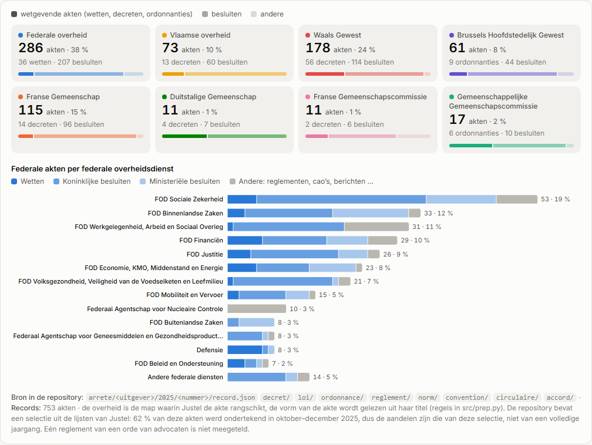

#### 2. Van ondertekening tot Staatsblad

Dagen van de ondertekening tot de bekendmaking in het Belgisch Staatsblad, per overheid: een mediaan van 13 voor federale akten, 64 voor die van de Duitstalige Gemeenschap.

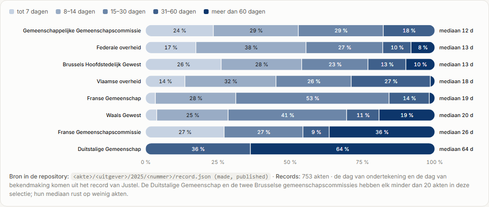

#### 3. Inwerkingtreding

Wanneer de akten van 2025 ingaan, geteld vanaf de bekendmaking: 6 % van de Waalse akten op de tiende dag, 4 % van die van de Franse Gemeenschap met terugwerkende kracht.

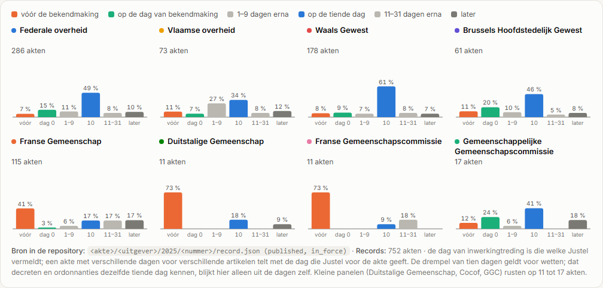

#### 4. Het Staatsblad in bladzijden

De doorlopende nummering van het Staatsblad: tot bladzijde 100.364 in 2025, en op 17 september 2026 2 % minder bladzijden dan een jaar eerder.

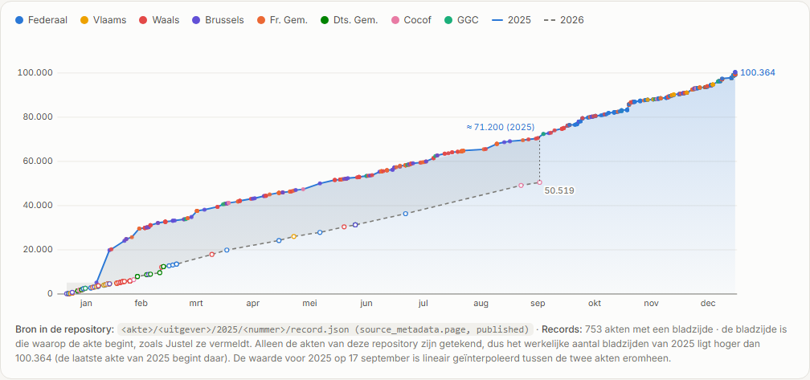

#### 5. Instemming met verdragen

Instemmingsakten met verdragen, per verdrag en partnerland: een mediaan van 6,9 jaar na de ondertekening; het Waals Parlement stemde in met 20 luchtvaartakkoorden.

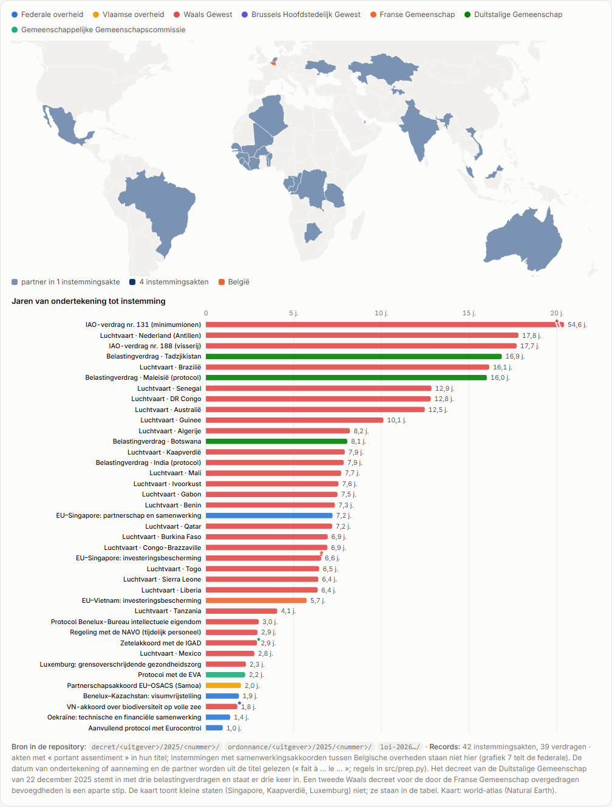

#### 6. Europese richtlijnen

Akten die zelf zeggen dat ze een Europese richtlijn omzetten: 45 akten en 36 richtlijnen, waarvan 6 door twee of drie overheden.

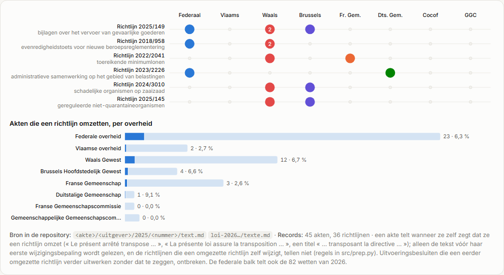

### II. Het federale parlement

#### 7. Kamer en Senaat

De procedure (artikel 74, 77 of 78 van de Grondwet) en de soort van de 117 federale wetten van oktober 2025 tot oktober 2026: 8 % regelt een aangelegenheid die de Kamer zonder de Senaat behandelt.

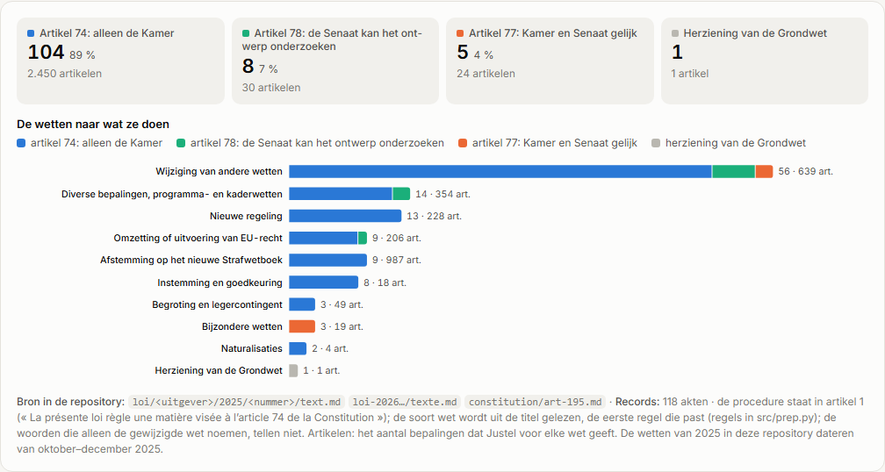

#### 8. De wetgevingskalender

Wijzigingswetten per maand sinds 1995, met de maanden van de federale verkiezingen: na 7 van de 8 verkiezingen volgden 5 tot 9 maanden zonder één wijzigingswet.

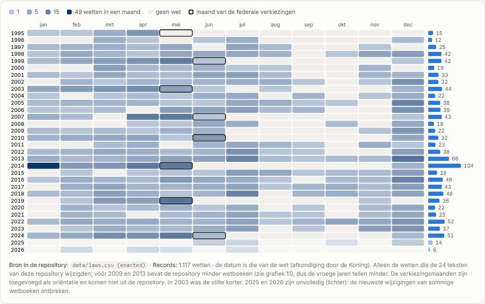

#### 9. Van afkondiging tot Staatsblad

Dagen van de datum van een wet tot haar bekendmaking, per jaar (mediaan 55 in 1997, 8 in 2021), en de dag van inwerkingtreding: 4 % op de tiende dag.

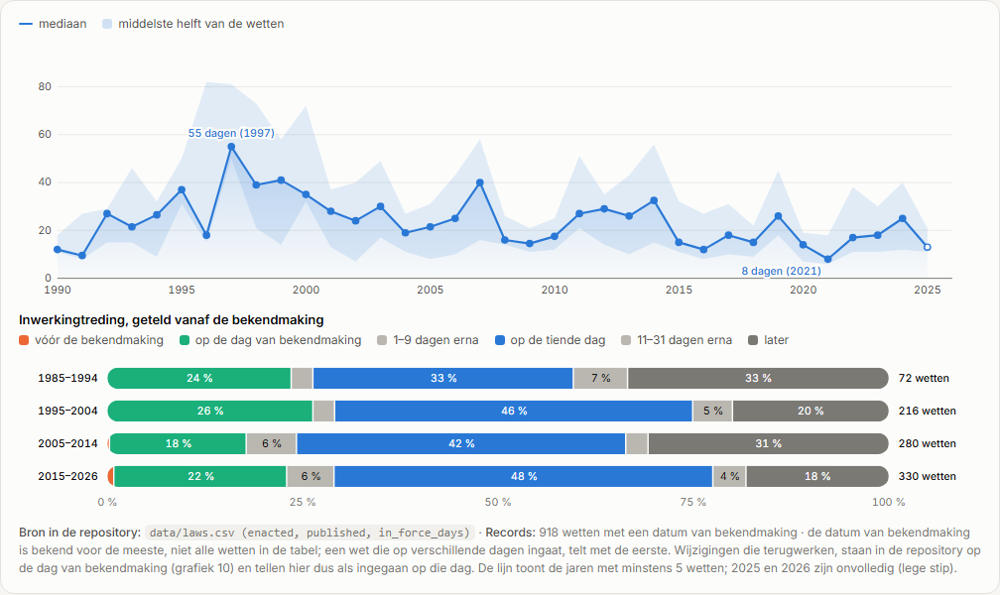

#### 10. Terugwerkende kracht

Wijzigingen van de wetboeken die ingingen vóór hun bekendmaking, per jaar en wetboek: 416, een mediaan van 95 dagen eerder.

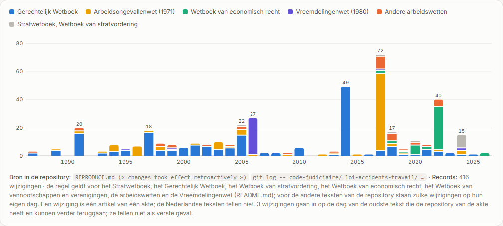

### III. De wetboeken

#### 11. De meest gewijzigde wetboeken

Nieuwe versies per jaar van elk wetboek en elke wet: het Gerechtelijk Wetboek 613 sinds 1985.

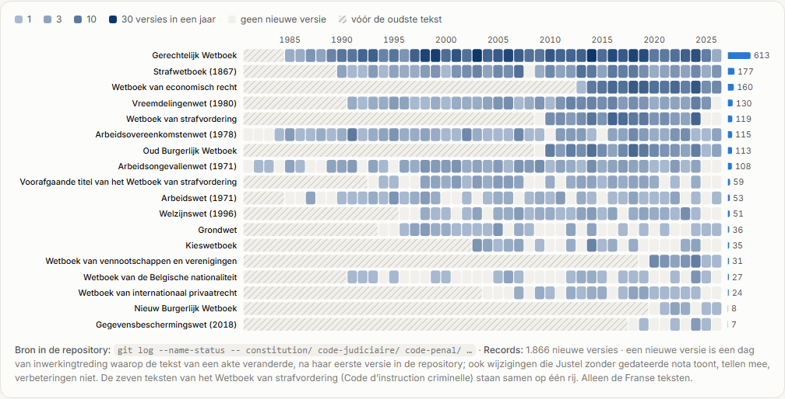

#### 12. De meest gewijzigde artikelen

De 20 artikelen die het vaakst een nieuwe tekst kregen: art. 569 van het Gerechtelijk Wetboek 30 keer.

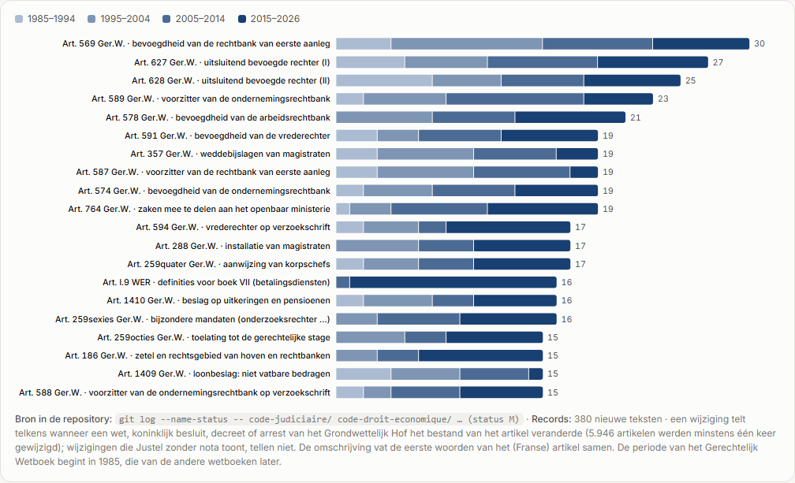

#### 13. Ingevoegde artikelen

De artikelnummers van acht wetboeken en wetten door de jaren heen, gewoon, met bis of ter, of met een schuine streep: de Vreemdelingenwet telt er 452, waarvan 310 met een schuine streep.

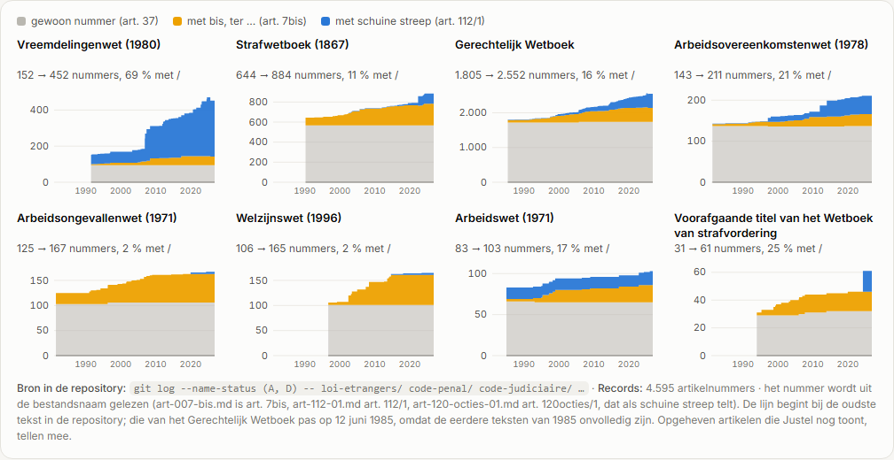

#### 14. Wanneer wijzigingen ingaan

De kalenderdag waarop wijzigingen van de wetboeken in werking treden: 218 op 1 januari, 86 op 1 september.

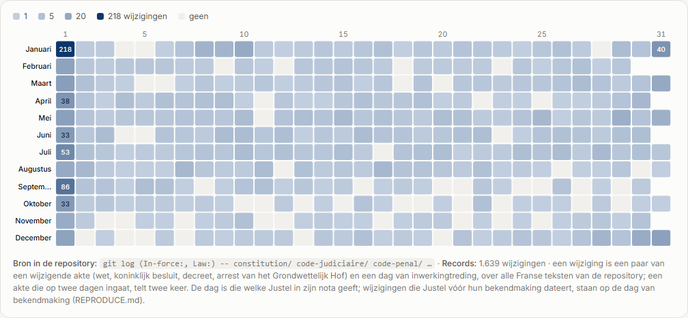

#### 15. Vier nieuwe wetboeken

De boeken van het Wetboek van economisch recht, het Wetboek van vennootschappen en verenigingen, het nieuwe Burgerlijk Wetboek en het nieuwe Strafwetboek, van de wet tot de inwerkingtreding: 29 boeken en delen, 5.387 artikelen.

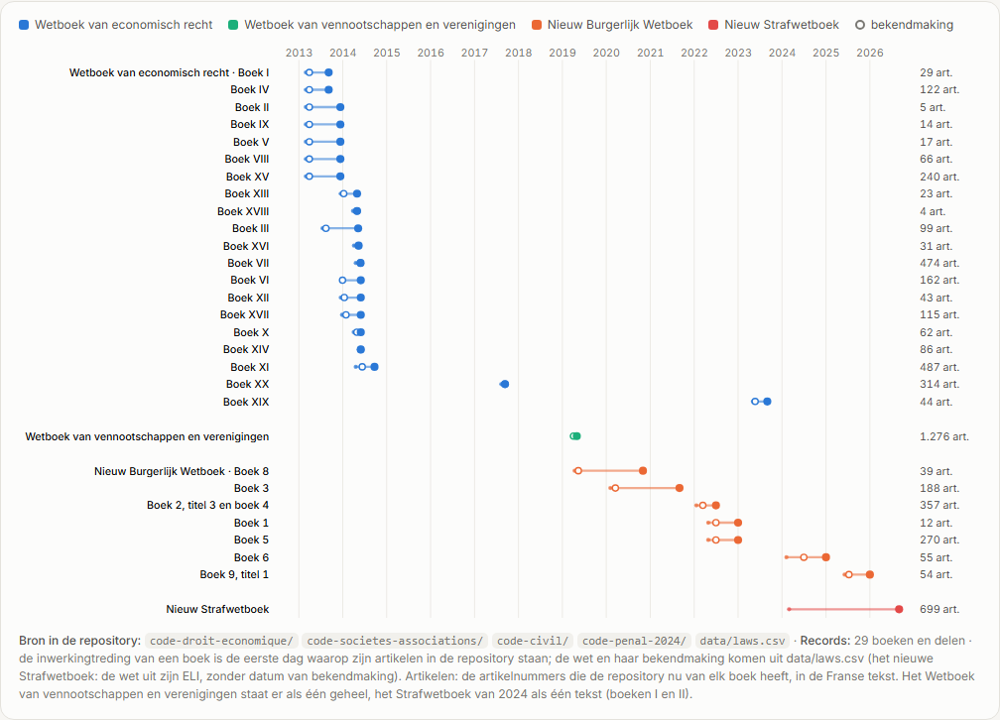

#### 16. Het nieuwe Strafwetboek

De 481 strafbepalingen van het nieuwe Strafwetboek naar strafniveau: 4 % op niveau 2 of 3.

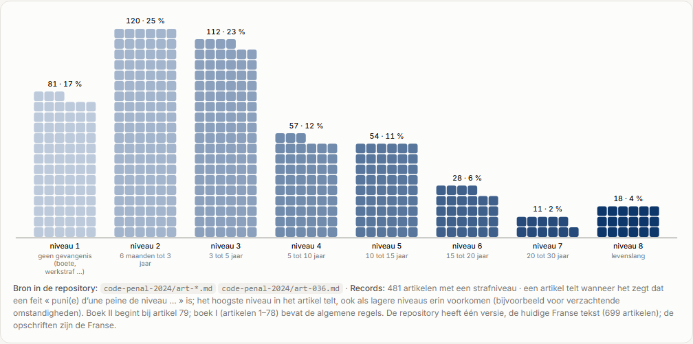

### IV. De Grondwet en de hoven

#### 17. De Grondwet sinds 1994

De herzieningen van de Grondwet sinds 1994, per deel en per jaar: 82, waarvan 42 van 6 januari 2014.

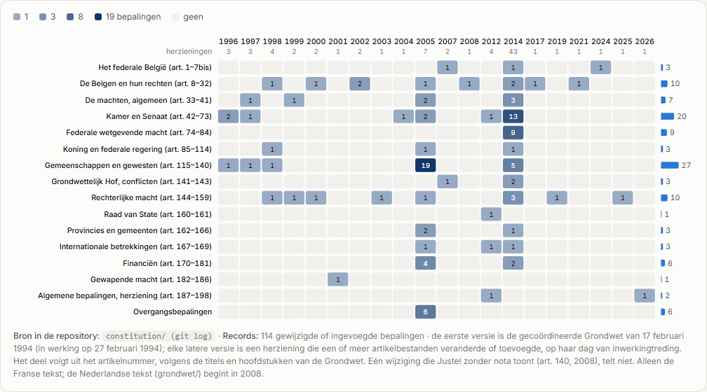

#### 18. Het Grondwettelijk Hof in de wetboeken

De 18 arresten van het Grondwettelijk Hof die woorden uit de wetboeken schrapten, met de dagen tot het Staatsblad: een mediaan van 26.

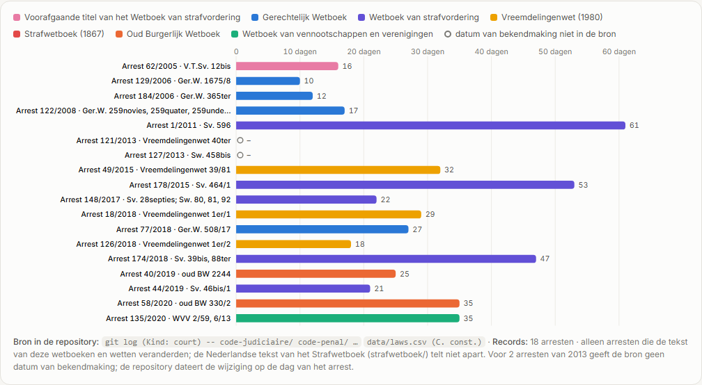

#### 19. Het Hof van Cassatie op Juportal

Dagen van de uitspraak tot de publicatie op Juportal: een mediaan van 6 voor strafarresten, 25 voor burgerlijke, 54 voor conclusies.

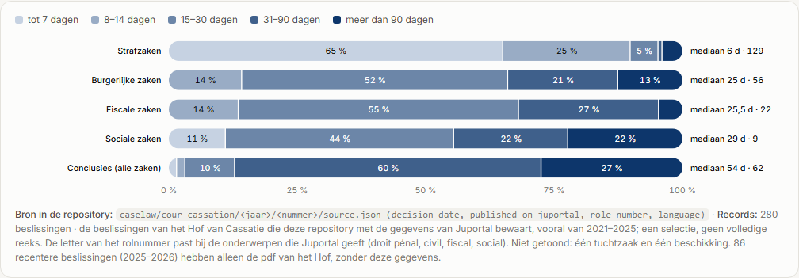

#### 20. De Raad van State in 1994–1996

Arresten van de Raad van State per maand volgens hun nummering, en de kamers naar taal: gemiddeld 522 per maand, 131 in augustus 1995.

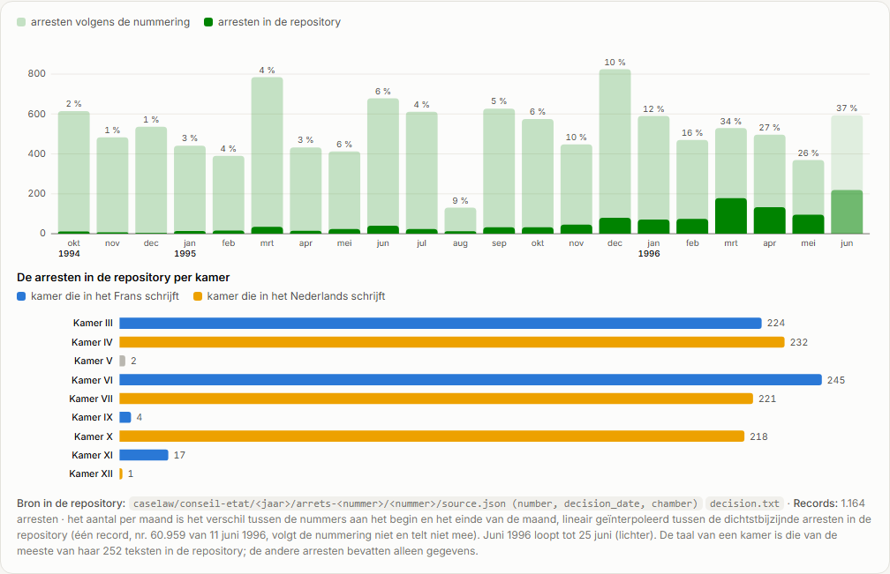

## Gegevens

Op commit `74e1bf145f`, gebouwd op 16 november 2026.

| Gegevens | Waar in de repository | Records | Dekking |
| --- | --- | ---: | --- |
| Git-geschiedenis | branch `main` | 4.742 commits | elke versie op de dag van inwerkingtreding (`In-force:`) |
| Grondwet, wetboeken en wetten | `constitution/`, `code-judiciaire/`, `code-penal/` … (24 Franse en 5 Nederlandse teksten) | 2.097 versies | 1981–2026, vanaf de oudste tekst in het archief van Justel |
| Wijzigende akten | `data/laws.csv` | 1.327 akten (1.226 wetten) | 1982–2026 |
| Wijzigingen met terugwerkende kracht | `REPRODUCE.md` | 416 | bekendgemaakt 1987–2026 |
| Akten van 2025 | `arrete/`, `decret/`, `loi/`, `ordonnance/`, `reglement/`, `norm/`, `convention/`, `circulaire/`, `accord/` | 753 akten | ondertekend in 2025, 6 % in oktober–december |
| Federale wetten van 2026 | `loi-2026…/` | 82 wetten | januari–oktober 2026 |
| Nieuw Strafwetboek | `code-penal-2024/` | 699 artikelen | in werking sinds 1 september 2026 |
| Hof van Cassatie | `caselaw/cour-cassation/` | 366 beslissingen (280 met de gegevens van Juportal) | vooral 2021–2026 |
| Raad van State | `caselaw/conseil-etat/` | 1.164 arresten (252 met tekst) | juli 1994 – juni 1996 |

## Beperkingen

- **De akten van 2025 zijn een selectie.** De repository bevat de akten uit de eerste bladzijden van de lijsten van Justel, de meeste ondertekend in oktober–december 2025; de aandelen in de grafieken 1 tot 6 zijn die van deze selectie, niet van een volledige jaargang.
- **De wetboeken beginnen in het archief van Justel.** De meeste wetboeken en wetten beginnen bij de oudste tekst die Justel bewaart (het Gerechtelijk Wetboek in 1985, het Strafwetboek in 1990, het oud Burgerlijk Wetboek en het Wetboek van strafvordering in 2009), niet zoals ze werden aangenomen; vroege jaren tellen dus minder wetboeken (grafieken 8 tot 14).
- **Categorieën komen uit titels en teksten.** De soort akte (grafieken 1 en 7), de instemming met verdragen (5), de omzetting van richtlijnen (6), de procedure van de federale wetten (7) en de strafniveaus (16) worden gelezen uit titels en teksten, volgens de regels in `src/prep.py`.
- **Terugwerkende kracht** staat in de repository op de dag van bekendmaking (grafiek 10); in de grafieken 9 en 14 telt die dag.
- **Eén gegeven komt van buiten de repository:** de maanden van de federale verkiezingen in grafiek 8, als oriëntatie.
- **De rechtspraak is een selectie** (grafieken 19 en 20): vooral gegevens en de officiële link, met de tekst voor een deel van de beslissingen.
- **Onvolledige perioden** (2025 en 2026 in de wetboeken, juni 1996 bij de Raad van State) zijn lichter getekend.

## Opnieuw bouwen

```sh
python visualisations/src/make.py            # git-geschiedenis + tabellen + teksten -> src/.build/ -> belgisch-recht-in-20-grafieken.html
node visualisations/src/stills.cjs           # afbeeldingen voor deze README's (Playwright nodig; PLAYWRIGHT=<pad> als het niet globaal is)
```

`make.py` leest alles uit git-objecten, dus het werkt ook in een blobless kloon of een kloon met `--no-checkout` (het haalt de blobs die het nodig heeft op in één verzoek per stap). Het leest standaard `origin/main` (of `HEAD`); `--ref` kiest een andere branch of commit. Het schrijft niets in de repository behalve de pagina en de map `src/.build/` (die git negeert).

| Bestand | Wat het doet |
| --- | --- |
| `src/make.py` | haalt de geschiedenis, de tabellen en de teksten op in `src/.build/` en draait dan `prep.py` en `build.py` |
| `src/prep.py` | berekent elk getal van de 20 grafieken en het gegevensprofiel in `src/.build/data.json` |
| `src/page.tpl.html` | de pagina: de tekst in drie talen, de grafieken (d3), de tabellen |
| `src/build.py` | zet `data.json` in het sjabloon en schrijft de pagina |
| `src/stills.cjs` | tekent elke grafiek als png in `stills/nl/`, `stills/fr/` en `stills/en/` |
