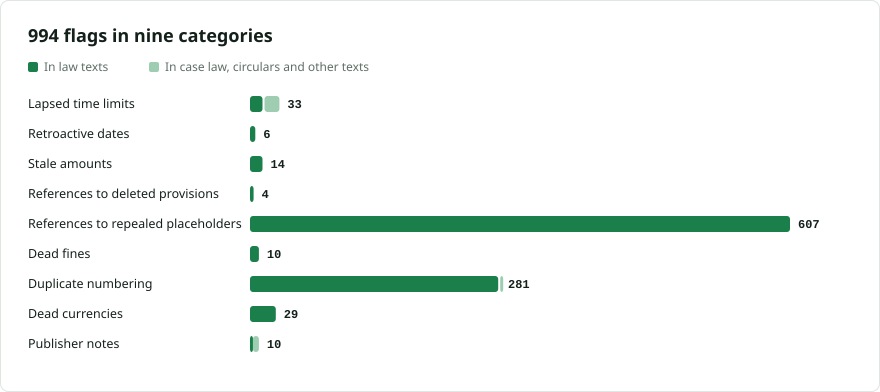

# Vulnerabilities in Belgian law

[Nederlands](README.md) · **English**

<picture>
<source media="(prefers-color-scheme: dark)" srcset="img/flags-by-category-dark.svg">

</picture>

The vulnerability detectors from [lexifina/global-law](https://github.com/lexifina/global-law/tree/main/vulnerabilities) look for mechanical mistakes in legislation: a rule applying "until" a date that has passed, a provision repealed before its replacement took effect, two amendments to the same provision on the same day, a reference to an article that no longer exists. global-law's published list (9 November 2026) did not include Belgium, so this is a run over this repository only, as it stood at commit [`7468af3`](https://github.com/lexifina/belgium-law/commit/7468af3b4ad5c4656e78f53439ba3add6eebdecc) on 15 November 2026, with the codes and laws it follows through Justel, the federal laws of 2026, the regional and community acts of 2025, and the case law and circulars it also holds.

**In short:** the detectors raised 994 flags. A language model reviewed 57 of the strongest, arguing each one for and against; 6 survived. Checked by hand in this repository, none of them is a confirmed defect in Belgian law. Five are lawful: four point to the caps on directors' liability in art. 2:57 of the Code des sociétés et des associations, which keep their own figures when the 2024 size criteria changed, and one is a period that says which journeys a 2026 tax credit covers. One is a detector reading the former number an article of the loi sur les étrangers carries at its head ("ancien art. 52bis") as a reference. Later, this will be formalised in Lean, similar to our work on [the US tax code](https://lexifina.com/blog/formalizing-the-us-tax-code) and [US case law](https://lexifina.com/blog/formalizing-all-us-case-law-in-lean).

A flag is a prompt to look, not legal advice, and nothing here has been tested in court.

## Flags by category

| Category | What it looks for | Flags | In law texts | Reviewed | Survived review |
| --- | --- | ---: | ---: | ---: | ---: |
| Lapsed time limits | Text still applying a rule "until" a date that has passed | 33 | 14 | 33 | 1 |
| Retroactive or pre-publication dates | A change in force before the act that made it | 6 | 6 | 6 | 0 |
| Stale amounts | An amount changed in one place but still standing elsewhere | 14 | 14 | 14 | 4 |
| References to deleted provisions | A provision citing an article that no longer exists | 4 | 4 | 4 | 1 |
| References to repealed placeholders | A provision citing an article whose text now reads only "(Abrogé)" | 607 | 607 | 0 | 0 |
| Dead fines | A penalty clause citing an article that has been repealed | 10 | 10 | 0 | 0 |
| Duplicate numbering | Two units with the same number in one article or act | 281 | 279 | 0 | 0 |
| Dead currencies | Amounts in currencies no longer in use | 29 | 29 | 0 | 0 |
| Publisher notes | Notes that an amendment could not be carried out, or a "(sic)" | 10 | 1 | 0 | 0 |

"In law texts" counts the Constitution, the codes and laws, the arrêtés, décrets, ordonnances, règlements and other normative texts of the federal state, the regions and the communities, and the general police regulation of the City of Brussels. The other flags are in decisions of the Conseil d'État and the Cour de cassation and in ministerial circulars, which this repository also holds and which are not law. The search for repeal gaps, same-day conflicts and empty periods found nothing to flag: a repealed article keeps its file with the text "(Abrogé)", so there is no deleted file to find (those references are counted as references to repealed placeholders); where Justel credits one article's change on one day to several acts, this repository makes one commit, credited to one act, and names the others in an `Also-amended-by` trailer; and the regional acts and the 2026 laws hold one version each.

*Edge cases: the 6 flags that survived the review, grouped by what they turned out to be, and what the other flags are, in [EDGE-CASES.en.md](EDGE-CASES.en.md).*

## Problems found in this repository

- **Articles 259bis-1 and following of the Code judiciaire** have no file, though 13 of its articles cite 259bis-6, 259bis-8, 259bis-9, 259bis-13 or 259bis-19 as provisions in force. The history held instead the earlier art. 259bis (the collège de recrutement des magistrats, last changed by L 1997-07-09/47) until a change without an amendment note removed it on 1 June 2025 ([the change](https://github.com/lexifina/belgium-law/commit/1289b503f8fd58e86ddf8cb69917a1e66911709d)). The detectors first read these numbers as art. 259bis; now that they read 259bis-9 as one number, they no longer flag them.
- **Art. 31 of the loi du 16 mai 2024** amending the Code belge de la Navigation has no file of its own: its text is at the end of [art-030.md](https://github.com/lexifina/belgium-law/blob/7468af3b4ad5c4656e78f53439ba3add6eebdecc/loi-navigation-2024/art-030.md), and the act's README lists no art. 31.

## Files

| File | What it holds |
| --- | --- |
| [data/flags.csv](data/flags.csv) | Every flag, one row per provision and issue |
| [data/reviewed.csv](data/reviewed.csv) | The 57 flags the model reviewed, with its verdict and reason |
| [data/by_category.csv](data/by_category.csv) | The counts in the table above |
| [tools/](tools/) | The scripts that made this run |

Columns: `category` and `category_nl` (the category in English and Dutch), `detector`, `kind` (`law` or `other`), `path` (the file in this repository), `date` (the date the flag turns on), `reference` (the act or line involved), `summary`, `score` (the detector's ranking, 0 to 1), `review` (`artefact`, `lawful` or `candidate_defect`), `survives_rebuttal`, `review_note` (the model's reason, in English), `url` (the provision at the commit that was read, or, for a change, the commit).

## How it was made

- **Detectors:** global-law's [vulnerabilities/scripts](https://github.com/lexifina/global-law/tree/main/vulnerabilities/scripts), run on this repository at commit `7468af3`. global-law's list did not include Belgium, so the history table the detectors read was built from this repository's own commits (the act that made each change, and the `In-force` and `Kind` trailers), counting the kinds `law`, `decree`, `court` and `local-regulation` as changes to the law. The detectors were then run again with fixes that read article numbers such as 259bis-9 as one number and know the Belgian franc (and no longer take "intitulé" for the Peruvian inti).
- **Model review:** gpt-5.4-mini, the 40 strongest flags per category, which here is every flag in the four categories it reviews, and for lapsed time limits also the 14 in law texts; one pass says whether a flag is real, a second argues that it is not. There were no empty periods to review. After the detector fixes, lapsed time limits and references to deleted provisions were reviewed again; where a flag was reviewed twice, the later review is kept. global-law's own list used a different model.
- **Hand check:** every case that survived was read in this repository's history and texts, against the amending act where the repository holds it. None is left open. The six retroactive dates, which the model judged to come from the record, were not checked against the Moniteur belge.

To report a correction, open an issue with the provision and an official source.

## Licence

The lists and notes are Lexifina's, dedicated to the public domain under CC0 1.0, like the rest of this repository's own contributions. Quoted texts are as Justel, Juportal and the Conseil d'État publish them; official acts are not protected by copyright in Belgium (Code de droit économique, art. XI.172, § 2). See [LICENSE](../LICENSE).
