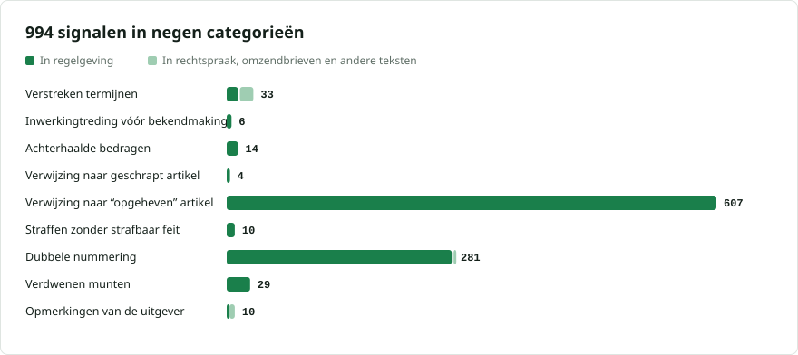

# Kwetsbaarheden in het Belgische recht

**Nederlands** · [English](README.en.md)

<picture>
<source media="(prefers-color-scheme: dark)" srcset="img/flags-by-category-dark.nl.svg">

</picture>

De kwetsbaarheidsdetectoren van [lexifina/global-law](https://github.com/lexifina/global-law/tree/main/vulnerabilities) zoeken naar mechanische fouten in regelgeving: een regel die nog geldt "tot" een datum die al voorbij is, een bepaling die werd opgeheven voordat haar vervanging in werking trad, twee wijzigingen van dezelfde bepaling op dezelfde dag, een verwijzing naar een artikel dat niet meer bestaat. De lijst die global-law op 9 november 2026 publiceerde, omvatte België niet. Dit is daarom een controle van alleen deze repository, zoals ze er op 15 november 2026 uitzag, op commit [`7468af3`](https://github.com/lexifina/belgium-law/commit/7468af3b4ad5c4656e78f53439ba3add6eebdecc), met de wetboeken en wetten die ze via Justel volgt, de federale wetten van 2026, de akten van de gewesten en gemeenschappen van 2025, en de rechtspraak en omzendbrieven die ze eveneens bevat.

**Kort samengevat:** de detectoren gaven 994 signalen. Een taalmodel beoordeelde de 57 sterkste en woog bij elk de argumenten voor en tegen af; 6 bleven overeind. Na een controle met de hand in deze repository is geen enkel ervan een bevestigde fout in het Belgische recht. Vijf zijn rechtmatig: vier wijzen naar de beperking van de aansprakelijkheid van bestuurders in art. 2:57 van de Code des sociétés et des associations, die haar eigen bedragen behoudt sinds de groottecriteria in 2024 werden verhoogd, en één is een periode die bepaalt voor welke verplaatsingen een belastingkrediet van 2026 geldt. Eén is een detector die het vroegere nummer dat een artikel van de loi sur les étrangers bovenaan vermeldt ("ancien art. 52bis"), als een verwijzing leest. Later wordt dit geformaliseerd in Lean, zoals ons werk aan [de belastingwetgeving van de VS](https://lexifina.com/blog/formalizing-the-us-tax-code) en [de rechtspraak van de VS](https://lexifina.com/blog/formalizing-all-us-case-law-in-lean).

Een signaal is een aanleiding om nader te kijken, geen juridisch advies, en niets hiervan is door een rechter getoetst.

## Signalen per categorie

| Categorie | Waarnaar het zoekt | Signalen | In regelgeving | Beoordeeld | Overeind na beoordeling |
| --- | --- | ---: | ---: | ---: | ---: |
| Verstreken termijnen | Tekst die een regel nog toepast "tot" een datum die al voorbij is | 33 | 14 | 33 | 1 |
| Inwerkingtreding vóór bekendmaking | Een wijziging die in werking treedt vóór de akte die haar aanbracht | 6 | 6 | 6 | 0 |
| Achterhaalde bedragen | Een bedrag dat op één plaats werd gewijzigd maar elders blijft staan | 14 | 14 | 14 | 4 |
| Verwijzingen naar geschrapte bepalingen | Een bepaling die verwijst naar een artikel dat niet meer bestaat | 4 | 4 | 4 | 1 |
| Verwijzingen naar “opgeheven” artikelen | Een bepaling die verwijst naar een artikel waarvan de tekst alleen nog "(Abrogé)" luidt | 607 | 607 | 0 | 0 |
| Straffen zonder strafbaar feit | Een strafbepaling die verwijst naar een opgeheven artikel | 10 | 10 | 0 | 0 |
| Dubbele nummering | Twee onderdelen met hetzelfde nummer in één artikel of akte | 281 | 279 | 0 | 0 |
| Verdwenen munten | Bedragen in munten die niet meer in gebruik zijn | 29 | 29 | 0 | 0 |
| Opmerkingen van de uitgever | Opmerkingen dat een wijziging niet kon worden aangebracht, of een "(sic)" | 10 | 1 | 0 | 0 |

"In regelgeving" omvat de Grondwet, de wetboeken en wetten, de besluiten, decreten, ordonnanties, reglementen en andere normatieve teksten van de federale staat, de gewesten en de gemeenschappen, en het algemeen politiereglement van de Stad Brussel. De overige signalen staan in arresten van de Raad van State en het Hof van Cassatie en in ministeriële omzendbrieven, die deze repository ook bevat en die geen regelgeving zijn. De zoektocht naar leemtes na opheffing, wijzigingen op dezelfde dag en lege periodes leverde niets op: een opgeheven artikel behoudt zijn bestand met de tekst "(Abrogé)", zodat er geen verwijderd bestand te vinden is (die verwijzingen worden geteld als verwijzingen naar “opgeheven” artikelen); waar Justel de wijziging van een artikel op één dag aan meerdere akten toeschrijft, maakt deze repository één commit, toegeschreven aan één akte, en noemt ze de andere in een trailer `Also-amended-by`; en de akten van de gewesten en gemeenschappen en de wetten van 2026 bevatten elk één versie.

*Randgevallen: de 6 signalen die na de beoordeling overeind bleven, gegroepeerd naar wat ze bleken te zijn, en wat de overige signalen zijn, in [EDGE-CASES.md](EDGE-CASES.md).*

## Problemen in deze repository

- **De artikelen 259bis-1 en volgende van de Code judiciaire** hebben geen bestand, hoewel 13 artikelen van dat wetboek naar 259bis-6, 259bis-8, 259bis-9, 259bis-13 of 259bis-19 verwijzen als geldende bepalingen. De geschiedenis bevatte in de plaats daarvan het vroegere art. 259bis (het collège de recrutement des magistrats, laatst gewijzigd bij L 1997-07-09/47), tot een wijziging zonder wijzigingsnota het op 1 juni 2025 verwijderde ([de wijziging](https://github.com/lexifina/belgium-law/commit/1289b503f8fd58e86ddf8cb69917a1e66911709d)). De detectoren lazen deze nummers eerst als art. 259bis; nu ze 259bis-9 als één nummer lezen, geven ze er geen signaal meer voor.
- **Art. 31 van de wet van 16 mei 2024** tot wijziging van de Code belge de la Navigation heeft geen eigen bestand: de tekst staat aan het einde van [art-030.md](https://github.com/lexifina/belgium-law/blob/7468af3b4ad5c4656e78f53439ba3add6eebdecc/loi-navigation-2024/art-030.md), en de README van de akte vermeldt geen art. 31.

## Bestanden

| Bestand | Inhoud |
| --- | --- |
| [data/flags.csv](data/flags.csv) | Elk signaal, één rij per bepaling en probleem |
| [data/reviewed.csv](data/reviewed.csv) | De 57 signalen die het model beoordeelde, met zijn oordeel en motivering |
| [data/by_category.csv](data/by_category.csv) | De aantallen uit de tabel hierboven |
| [tools/](tools/) | De scripts waarmee deze controle werd uitgevoerd |

Kolommen: `category` en `category_nl` (de categorie in het Engels en het Nederlands), `detector`, `kind` (`law` of `other`), `path` (het bestand in deze repository), `date` (de datum waarop het signaal betrekking heeft), `reference` (de betrokken akte of regel), `summary`, `score` (de rangschikking door de detector, 0 tot 1), `review` (`artefact`, `lawful` of `candidate_defect`), `survives_rebuttal`, `review_note` (de motivering van het model, in het Engels), `url` (de bepaling in de gecontroleerde commit, of bij een wijziging de commit zelf).

## Hoe het tot stand kwam

- **Detectoren:** de [vulnerabilities/scripts](https://github.com/lexifina/global-law/tree/main/vulnerabilities/scripts) van global-law, uitgevoerd op deze repository in commit `7468af3`. De lijst van global-law omvatte België niet; de geschiedenistabel die de detectoren lezen, werd daarom opgebouwd uit de eigen commits van deze repository (de akte die elke wijziging aanbracht, en de trailers `In-force` en `Kind`), waarbij de soorten `law`, `decree`, `court` en `local-regulation` als wijzigingen van het recht gelden. Daarna werden de detectoren opnieuw uitgevoerd met correcties waardoor ze artikelnummers als 259bis-9 als één nummer lezen en de Belgische frank kennen (en "intitulé" niet langer voor de Peruaanse inti houden).
- **Beoordeling door het model:** gpt-5.4-mini, de 40 sterkste signalen per categorie, wat hier neerkomt op elk signaal in de vier categorieën die het beoordeelt, en bij de verstreken termijnen ook de 14 in regelgeving; een eerste ronde zegt of een signaal echt is, een tweede voert aan dat het dat niet is. Er waren geen lege periodes te beoordelen. Na de correcties van de detectoren werden de verstreken termijnen en de verwijzingen naar geschrapte bepalingen opnieuw beoordeeld; waar een signaal tweemaal werd beoordeeld, geldt de latere beoordeling. De eigen lijst van global-law gebruikte een ander model.
- **Controle met de hand:** elk geval dat overeind bleef, werd gelezen in de geschiedenis en de teksten van deze repository, en vergeleken met de wijzigende akte waar de repository die bevat. Geen enkel geval blijft open. De zes datums van inwerkingtreding vóór de akte, die het model aan de opbouw van het archief toeschreef, werden niet nagekeken in het Belgisch Staatsblad.

Meld een correctie in een issue, met de bepaling en een officiële bron.

## Licentie

De lijsten en toelichtingen zijn van Lexifina en vallen in het publieke domein onder CC0 1.0, net als de andere eigen bijdragen van deze repository. Geciteerde teksten zijn zoals Justel, Juportal en de Raad van State ze publiceren; officiële akten zijn in België niet auteursrechtelijk beschermd (Code de droit économique, art. XI.172, § 2). Zie [LICENSE](../LICENSE).
